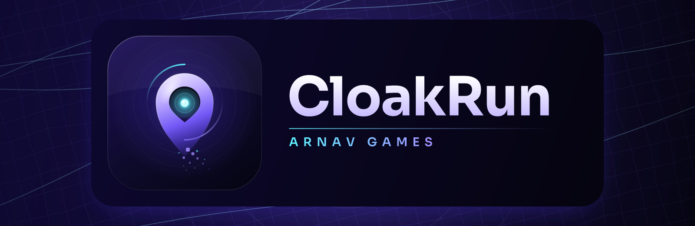

<p align="center">
  
</p>

<p align="center">
  <a href="https://github.com/Arnav-Dugad/CloakRun/releases/latest"></a>
  <a href="https://github.com/Arnav-Dugad/CloakRun/actions/workflows/ci.yml"></a>
  
</p>

# CloakRun

**Premium real-world hide and seek, played across a real city.**

Hiders run and cloak. Seekers sweep with radar, follow clues and close in for a tag. The whole match plays out on a
striking night map in a dark, glassy, cinematic interface.

The core promise: **a hider's exact position never leaves their phone.** Seekers only ever see a shrinking, breathing,
fuzzy last-known zone. That makes every match fair and tense, and makes cheating hard by design.

## Features

- **Real-city play area.** The host draws a circle or polygon over a neighbourhood, campus or park.
- **Privacy by design.** Exact GPS stays on your device. The cloud sees a fuzzed zone that shrinks over time.
- **Proximity tagging over Bluetooth.** A tag needs the seeker's phone to actually hear the hider's rotating
  ephemeral ID at close range. Spoofing GPS doesn't get you a catch.
- **Powers earned in the field.** Cloak, Decoy, Sonar Pulse, Echo, Freeze Trap, Blackout and Phantom Swap, collected
  at glass-crystal cache points on walkable paths. Powers are never sold.
- **Modes.** Classic, Infection, Shrinking Zone, Capture the Cloak, Night Run and Heist.
- **A custom night map.** Luminous road networks, breathing metaball zones, radar sweeps, fog of war and comet trails.
- **Frost Glass interface.** Continuous-curve glass surfaces, a tilt-reactive specular sheen, spring physics
  everywhere, and a full haptic vocabulary.
- **Safety first.** Private lobbies only, quick-chat presets, SOS, an age gate, vehicle detection and mandatory
  stay-safe rules.

## Screenshots

Screenshots are added as each phase ships. See the [Releases](https://github.com/Arnav-Dugad/CloakRun/releases) page
for what is playable today.

## Download

Grab the latest `CloakRun-vX.Y.Z.apk` from
[Releases](https://github.com/Arnav-Dugad/CloakRun/releases/latest). Each release lists the SHA-256 of every file.
Sideloaded builds update themselves in-app once the updater ships.

## Building

Requirements: JDK 21 or newer (Android Studio's bundled JBR works) and the Android SDK.

```bash
./gradlew assembleSideloadDebug        # debug APK
./gradlew spotlessCheck detekt lint    # formatting and static analysis
./gradlew testSideloadDebugUnitTest    # unit and screenshot tests
```

Firebase is optional for local builds. Without `app/google-services.json` the app builds and runs in offline mode.
See [docs/FIREBASE_SETUP.md](docs/FIREBASE_SETUP.md) to connect a project.

## Documentation

- [Architecture](docs/ARCHITECTURE.md)
- [Decisions](docs/DECISIONS.md)
- [Firebase setup](docs/FIREBASE_SETUP.md)
- [Quota budget](docs/QUOTA_BUDGET.md)
- [Releasing](docs/RELEASING.md)
- [Test plan](docs/TEST_PLAN.md)
- [Changelog](CHANGELOG.md)

## Licence

Copyright (c) 2026 Arnav Games. All rights reserved. See [LICENSE](LICENSE).

<p align="center"><sub>Made by Arnav Games</sub></p>
